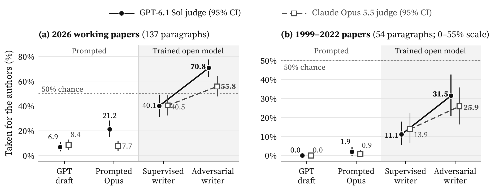

# Can a Language Model Write Like an Economist? — Replication Package

[](https://github.com/kansoy/ai-economist/actions/workflows/replicate.yml)
[-111111)](https://fatih.ai/ai_economist.pdf)
[](https://github.com/kansoy/ai-economist/releases/tag/v2026.11.24)
[](LICENSE)

Replication code, training and evaluation scripts, and anonymised evaluation data for *Can a Language Model Write Like an Economist?* (Fatih Kansoy, University of Oxford, November 2026; revised 20-page working paper, 24 November 2026).

- **Working Paper (20 pages):** [fatih.ai/ai_economist.pdf](https://fatih.ai/ai_economist.pdf) · [GitHub Release `v2026.11.24`](https://github.com/kansoy/ai-economist/releases/tag/v2026.11.24)
- **Research Summary:** [fatih.ai/research/ai_economist/](https://fatih.ai/research/ai_economist/)
- **Project Page:** [fatih.ai/projects/ai-economist/](https://fatih.ai/projects/ai-economist/)
- **Release Note:** [fatih.ai/news/2026-11-19-ai-economist/](https://fatih.ai/news/2026-11-19-ai-economist/)

## Abstract

In most comparisons against economists' prose, outside judges told them apart even with detailed rules and examples. On one rented GPU we fine-tuned an open model without explicit rules on 5,267 pairs of drafts and pre-2023 authors' paragraphs, then trained it against a co-trained judge providing a length-adjusted authorship reward. This adversarial training improved performance by 21.1 and 20.8 percentage points on 191 records in two runs, with similar gains among paragraphs within 5 per cent of supervised revision length. For 2026 working papers, GPT-6.1 Sol chose the final revisions 70.8 and 68.2 per cent of the time (both higher than chance) while Claude Opus 5.5 chose them 55.8 and 54.4 per cent of the time (well ahead of raw drafts and the guided model). Humans facing trained writers picked out authors' prose 41.0 per cent of the time (pooled) versus 61.8 per cent for raw drafts. Blind annotators judged the trained writers to alter claims more often than the guided model, so authors have to check the meaning.

## Headline Results



All estimates below are reproduced verbatim by `python3 run_all.py` from `data/`:

| Benchmark / Metric | GPT-6.1 Sol | Claude Opus 5.5 | Notes |
|---|---:|---:|---|
| Raw GPT draft — 2026 papers (`N = 137`) | 6.9% | 8.4% | 0.0% / 0.0% on 1999–2022 (`N = 54`) |
| Guided Opus + writing guide — 2026 papers (`N = 137`) | 21.2% | 7.7% | 1.9% / 0.9% on 1999–2022 (`N = 54`) |
| Supervised 31B writer, Step 0 (Run 1) — 2026 papers | 40.1% | 40.5% | 11.1% / 13.9% on 1999–2022 |
| Adversarial 31B writer, Final (Run 1) — 2026 papers | **70.8%** | **55.8%** | 31.5% / 25.9% on 1999–2022 |
| Adversarial 31B writer, Final (Run 2) — 2026 papers | **68.2%** | **54.4%** | 25.9% / 25.0% on 1999–2022 |
| Pooled adversarial gain (all 191 records, both judges) | **+21.1 pp** (Run 1) | **+20.8 pp** (Run 2) | 95% CIs `(15.4, 26.6)` and `(15.6, 26.0)`; 5/5 rules met |
| Equal-length subset (within 5% of Step 0 revision length) | **+21.4 pp** (`n = 124`) | **+19.3 pp** (`n = 135`) | 95% CIs `(14.8, 28.1)` and `(13.4, 25.2)` |
| Fidelity-adjusted Run 1 gain (major flag = failure) | **+14.1 pp** | **+19.1 pp** | 95% CIs `(8.7, 20.1)` and `(13.0, 25.3)` |
| Human reading test (23 readers, 95 answers, pooled) | 41.0% vs. trained | 61.8% vs. raw draft | Difference `20.8 pp`, 95% CI `(6.9, 35.1)` |

## Quickstart: One-Command Reproduction

Requires **Python 3.10+**. From the repository root:

```bash
python3 -m venv .venv
source .venv/bin/activate
pip install -r requirements.txt
python3 run_all.py
```

`run_all.py` runs `code/01_main_results.py` through `code/04_figures.py` sequentially, writes all tables to `output/tables/` and figures to `output/figures/`, and asserts every headline estimate, baseline, confidence-interval rule, content-fidelity check, and reading-test count against the working paper.

- **Typography fallback:** When LuaLaTeX with Source Serif Pro is installed, `code/04_figures.py` embeds exact manuscript typography via Matplotlib's `pgf` backend; otherwise it falls back automatically to embedded TrueType vector PDF and 300-DPI PNG output (verified in GitHub Actions on Ubuntu).

## Training & Evaluation Pipeline (`training/`)

Re-running GPU training requires a single 80 GB CUDA GPU (`google/gemma-4-31B-it` in 4-bit NF4) with `torch`, `transformers`, `peft`, `bitsandbytes`, and `safetensors`. Outside evaluation scripts read `OPENAI_API_KEY` and `ANTHROPIC_API_KEY` from standard environment variables.

| Stage | Script | Purpose |
|---|---|---|
| Prompts | `training/prompts.py` | Exact draft, writer, internal-judge, outside-judge, and content-fidelity prompts (Online Appendix A) |
| Step 1 & Judge Pre-Training | `training/train_supervised.py` | Supervised fine-tuning of the writer LoRA on 5,267 pairs (`writer`) and solo pre-training of the internal judge on 1,225 clean pairs (`judge`) |
| Step 2 Adversarial GRPO | `training/adversarial_trainer.py` | Single-GPU 3-adapter trainer (writer, frozen Step 1 KL anchor, co-trained judge) with order-balanced log-odds reward, within-group log-length debiasing, replay buffer, and accuracy-floor pausing |
| Outside Judge Scoring | `training/evaluate_judges.py` | Order-balanced blind authorship evaluation under GPT-6.1 Sol and Claude Opus 5.5 with paper-clustered bootstrap CIs |
| Content-Fidelity Audit | `training/evaluate_fidelity.py` | Blind category-level content audit (`dropped`, `added`, `hedge`, `entity`, `meaning`, overall verdict) against each input draft |

## Repository Structure

```text
.
├── run_all.py                  # One-command reproduction and assertion suite
├── requirements.txt            # Minimal replication dependencies (matplotlib, numpy)
├── DATA_DICTIONARY.md          # Complete field-level schema for data/*.jsonl
├── CHANGELOG.md                # Release history
├── CITATION.cff                # Machine-readable citation metadata
├── LICENSE                     # MIT Licence
├── .github/workflows/
│   └── replicate.yml           # Continuous replication CI on Ubuntu / Python 3.12
├── assets/
│   └── fig2_attribution.png    # Preview of Figure 2 rendered from code/04_figures.py
├── code/
│   ├── 01_main_results.py      # Baselines, Table 2, equal-length subset, 5 decision rules
│   ├── 02_content_fidelity.py  # Table A2 (Panel A, differences, Panel B joint outcomes)
│   ├── 03_reading_test.py      # Human reading-test estimates and reader-clustered CIs
│   └── 04_figures.py           # Figures 2, A1, and A2 (vector PDF + 300-DPI PNG)
├── data/
│   ├── test_metadata.jsonl
│   ├── run1_verdicts.jsonl
│   ├── run2_verdicts.jsonl
│   ├── baseline_verdicts.jsonl
│   ├── run1_summary.jsonl
│   ├── run2_summary.jsonl
│   ├── baseline_summary.jsonl
│   ├── fidelity_annotations.jsonl
│   ├── reading_test.jsonl
│   ├── training_log_run1.jsonl
│   └── training_log_run2.jsonl
├── training/
│   ├── prompts.py
│   ├── train_supervised.py
│   ├── adversarial_trainer.py
│   ├── evaluate_judges.py
│   └── evaluate_fidelity.py
└── output/                     # Generated by run_all.py (gitignored)
    ├── tables/
    └── figures/
```

## Exhibit Map

| Paper Exhibit | Script | Output File |
|---|---|---|
| Baselines (Section 4 & Figure 2: GPT draft and guided Opus) | `code/01_main_results.py` | `output/tables/baselines.csv`, `output/tables/main_results.json` |
| Table 2 (Outside judges before and after adversarial training, including Panel C equal-length subset within 5% of Step 0 supervised revision length) | `code/01_main_results.py` | `output/tables/table2_main.csv`, `output/tables/main_results.json` |
| Table A2 (Content fidelity of each version against its draft, Panel A differences, and Panel B joint outcomes using Run 1 supervised writer as baseline) | `code/02_content_fidelity.py` | `output/tables/tableA2_fidelity.csv`, `output/tables/tableA2_joint.csv`, `output/tables/content_fidelity.json` |
| Reading test statistics (Section 4 & Figure A2; 23 readers, 95 answers as of 17 November 2026) | `code/03_reading_test.py` | `output/tables/reading_test.json` |
| Figure 2 (How often each version is taken for the authors' paragraph) | `code/04_figures.py` | `output/figures/fig2_attribution.pdf`, `.png` |
| Figure A1 (Training dynamics in the two runs) | `code/04_figures.py` | `output/figures/figA1_training.pdf`, `.png` |
| Figure A2 (Readers choosing the human paragraph) | `code/04_figures.py` | `output/figures/figA2_readers.pdf`, `.png` |

## Data Availability Note

The original corpus paragraphs come from other researchers' papers and cannot be redistributed in full. The main drafting, training, and judging prompts appear in the Online Appendix (`training/prompts.py`). Every anonymised verdict, content-fidelity rating, training log, word count, number-retention indicator, and reading-test answer required to reproduce every table, figure, confidence interval, and decision rule in the paper is provided directly in `data/`. See `DATA_DICTIONARY.md` for schema details.

## Citation

```bibtex
@unpublished{kansoy2026aieconomist,
  title  = {Can a Language Model Write Like an Economist?},
  author = {Fatih Kansoy},
  note   = {University of Oxford Working Paper},
  month  = nov,
  year   = {2026},
  url    = {https://fatih.ai/ai_economist.pdf}
}
```

## Licence

Code is released under the MIT Licence (`LICENSE`).
